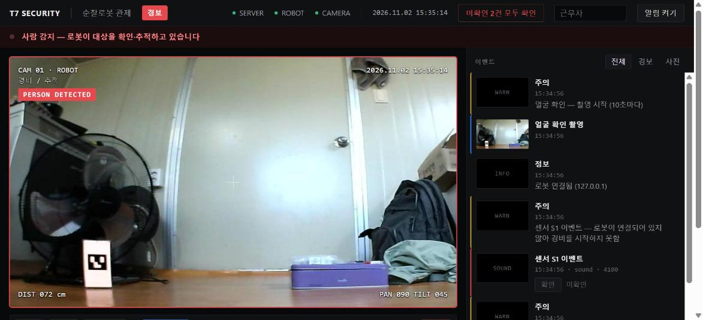
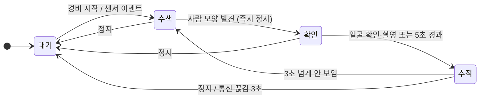
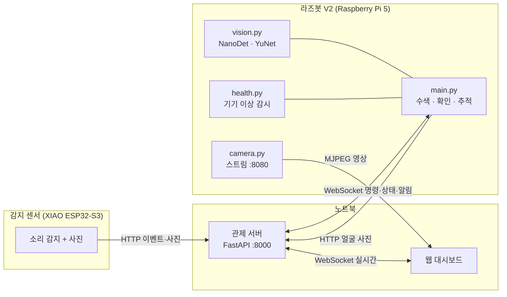
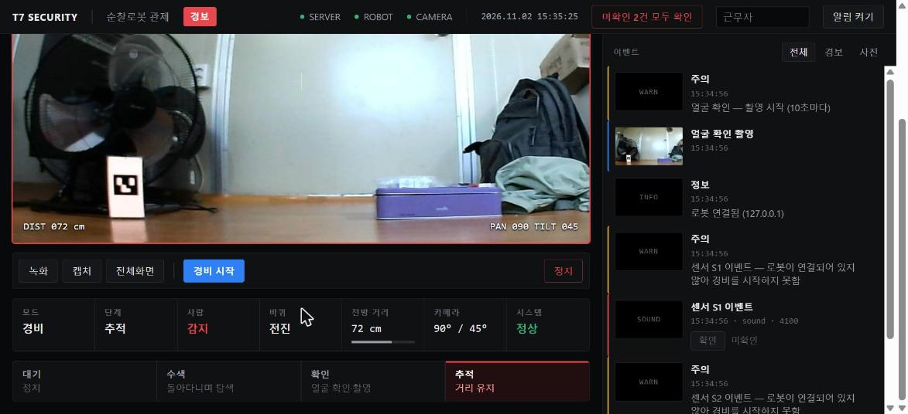

# Team 7 경비로봇

> 방을 스스로 돌아다니며 사람을 찾고, 얼굴을 확인해 촬영하고, 거리를 지키며 따라가는 경비로봇과
> 이를 CCTV 관제실처럼 지켜보는 웹 관제 시스템




<br>

## 목차

1. [프로젝트 소개](#프로젝트-소개)
2. [주요 기능](#주요-기능)
3. [동작 방식](#동작-방식)
4. [시스템 구성](#시스템-구성)
5. [관제 대시보드](#관제-대시보드)
6. [기기 이상 감시](#기기-이상-감시)
7. [검증 결과](#검증-결과)
8. [설치와 실행](#설치와-실행)
9. [주요 설정값](#주요-설정값)
10. [서버 API](#서버-api)
11. [개발 과정](#개발-과정)
12. [한계와 다음 과제](#한계와-다음-과제)
13. [협업 규칙](#협업-규칙)

<br>

## 프로젝트 소개

Yahboom 라즈봇 V2(Raspberry Pi 5)를 기반으로 만든 **자율 경비로봇**입니다.

정해진 경로를 따라가는 대신 **방을 직접 돌아다니며 사람을 찾고**, 사람이 보이면 멈춰서 카메라를 올려 **얼굴을 확인·촬영**한 뒤 **일정한 거리를 지키며 따라갑니다.** 모든 상황은 노트북의 관제 서버를 거쳐 **웹 대시보드**에 실시간으로 표시되고, 로봇이 외부 요인으로 통제를 벗어나면 즉시 알립니다.

| 구분 | 내용 |
|---|---|
| 로봇 | Yahboom 라즈봇 V2 (Raspberry Pi 5, 메카넘 휠, 2DOF 카메라 받침대, 초음파 센서) |
| 감지 센서 | Seeed XIAO ESP32-S3 Sense (카메라, 마이크) |
| 관제 | 노트북 (FastAPI 서버 + 웹 대시보드) |
| 인식 모델 | NanoDet-Plus (사람), YuNet (얼굴) — OpenCV Zoo |

<br>

## 주요 기능

| 기능 | 설명 |
|---|---|
| **수색** | 제자리에서 빙글빙글 돌지 않고 방을 돌아다니며 탐색. 휘어지며 이동하고, 벽에 가까워지면 미리 비켜 가며, 끼이면 후진 |
| **사람 인식** | 낮은 카메라에서도 다리·몸통처럼 **몸 일부만 보여도** 사람으로 인식 |
| **얼굴 확인** | 사람이 보이면 즉시 멈추고, 2축 카메라를 그쪽으로 돌린 뒤 위로 올려 얼굴을 찾음 |
| **자동 촬영** | 얼굴이 보이는 동안 **10초마다** 사진을 찍어 대시보드에 기록 |
| **추적** | 사람을 화면 가운데에 두고 따라감. 약 1m 앞에서 멈추고, 가까이 다가오면 뒤로 물러남 |
| **센서 연동** | XIAO 센서가 큰 소리를 감지하면 사진과 함께 알리고 로봇 경비 시작 |
| **관제 대시보드** | CCTV 관제 화면, 녹화와 캡처, 작동 단계 표시, 사람 감지 경보, 이벤트 확인 처리 |
| **기기 이상 감시** | 카메라 가림, 끼임·들림, 외부 힘으로 이동, 통신 끊김, 외부 기기 조작 등을 감지해 알림 |
| **안전 정지** | 서버 연결이 3초 넘게 끊기면 로봇이 스스로 멈춤 |

<br>

## 동작 방식

로봇은 세 단계를 오가며 경비합니다.



| 단계 | 로봇 동작 | 카메라 |
|---|---|---|
| **수색** | 3~6초씩 휘어지며 전진하고 방향을 무작위로 바꿈. 앞이 90cm 안이면 비켜 가고, 45cm 안이면 앞이 트일 때까지 제자리에서 틂 | 좌우로 천천히 훑으며 옆도 봄 |
| **확인** | 정지 | 사람 쪽으로 돌린 뒤 10°씩 올리며 얼굴 탐색 |
| **추적** | 사람을 화면 가운데에 두고 전진. 초음파 90cm 또는 사람이 화면 높이의 75% 이상이면 멈춤, 초음파 50cm 안이면 후진 | 정면 고정, 높이는 얼굴에 맞춤. 10초마다 촬영 |

같은 내용의 알림은 30초 안에 다시 보내지 않고, **상태가 바뀔 때만** 알립니다.

<br>

## 시스템 구성



모든 장비는 **같은 2.4GHz Wi-Fi**에 연결합니다. XIAO는 5GHz를 지원하지 않습니다.

### 폴더 구조

```
Team-7-robot/
├── robot/                 라즈봇 V2 (라즈베리파이)
│   ├── main.py            메인 루프 · 경비(수색 → 확인 → 추적) · 안전 정지 · 알림
│   ├── vision.py          사람 인식(NanoDet) · 얼굴 찾기(YuNet)
│   ├── health.py          기기 이상(통제불능) 감시
│   ├── hal.py             모터 · 초음파 · 2DOF 서보 제어
│   ├── camera.py          카메라 캡처 + MJPEG 스트리밍
│   ├── config.py          현장에서 튜닝하는 설정값
│   ├── download_models.py 인식 모델 내려받기
│   └── requirements.txt
├── server/                관제 서버 (노트북)
│   ├── app.py             FastAPI 서버 · WebSocket · 감시
│   └── static/index.html  관제 대시보드
├── xiao_node/
│   └── xiao_node.ino      XIAO ESP32-S3 감지 센서 (Arduino IDE)
├── docs/images/           README 이미지
└── arduino/               아두이노 추가 기능 (선택)
```

<br>

## 관제 대시보드

한화 Wisenet, UniFi Protect 같은 CCTV 관제 화면을 참고해 **검정에 가까운 톤**으로 만들었습니다.



| 영역 | 내용 |
|---|---|
| 상단 바 | 위험 등급(평상 · 경계 · 경보), SERVER · ROBOT · CAMERA 연결 상태, 날짜·시각, 근무자 이름 |
| 영상 | 실시간 카메라 영상 위에 카메라 이름, 시각, 전방 거리, 카메라 각도 표시. 사람 감지 시 빨간 테두리와 PERSON DETECTED |
| 도구 막대 | **녹화**(브라우저에서 바로 `.webm` 저장, 시각이 영상에 새겨짐), **캡처**(로봇 원본 사진을 기록에 남기고 내려받기), 전체화면, 경비 시작, 정지 |
| 상태 줄 | 모드, 단계, 사람, 바퀴 동작, 전방 거리 게이지, 카메라 각도, 시스템 상태 |
| 작동 단계 | 대기 · 수색 · 확인 · 추적 중 현재 단계를 강조 |
| 이벤트 | 썸네일 타임라인(전체 · 경보 · 사진 필터), 센서 이벤트 확인 처리와 확인자 기록 |
| 경보 | 사람 감지 경보 줄, 기기 이상 배너(확인할 때까지 유지), 경보음, 브라우저 알림 |

<br>

## 기기 이상 감시

로봇에 기울기 센서가 없어서, 이미 있는 **카메라 · 초음파 · 전원 · 통신** 정보로 판단합니다. 이상이 시작되면 한 번 알리고, 해소된 상태가 3초 이어지면 해소를 알립니다.

| 감시 위치 | 상황 | 판단 방법 |
|---|---|---|
| 로봇 | 카메라 고장·분리 | 3초 넘게 새 화면이 들어오지 않음 |
| 로봇 | 카메라 가림 | 화면이 3초 넘게 거의 새까맘 |
| 로봇 | 끼임·들림 | 바퀴를 돌리는데 4초 넘게 화면이 그대로 |
| 로봇 | 외부 힘으로 이동 | 멈춤 상태인데 화면 전체가 계속 밀림 (서보·바퀴 명령 직후 제외) |
| 로봇 | 센서·모터 보드 통신 이상 | I2C 통신 오류가 2초 넘게 계속 (반사 없음과 구분) |
| 로봇 | 전압 부족 · 과열 | 라즈베리파이 저전압 경고, CPU 80°C 이상 |
| 로봇 | **통신 끊김 시 안전 정지** | 서버 연결이 3초 넘게 끊기면 스스로 정지, 재연결 시 보고 |
| 서버 | 로봇 무응답 | 연결은 살아 있는데 5초 넘게 상태 보고 없음 |
| 서버 | 로봇 연결 끊김 | WebSocket 종료 |
| 서버 | 외부 조작 의심 | 처음 보는 기기에서 로봇 명령이 들어옴 |

<br>

## 검증 결과

실제 로봇 측정과, 카메라 지연(0.15초)·서보 특성 등 실측값을 넣은 시뮬레이션으로 확인했습니다.

**실제 로봇 측정 (Raspberry Pi 5)**

| 항목 | 결과 |
|---|---|
| 사람 인식 속도 | 1회 약 47ms |
| 추적 중 인식률 | 사람 100%, 얼굴 83% |
| 카메라 | 1280×720 MJPEG 30fps (웹 스트림은 640 폭) |

**시뮬레이션**

| 시나리오 | 결과 |
|---|---|
| 아무도 없는 방 3분 수색 (4m / 6m / 8m) | 앞으로 이동하는 시간 73% / 78% / 79%, 벽 충돌 없음 |
| 1.2m 안에서만 보이는 먼 사람 찾기 | 44초 만에 발견 |
| 가만히 선 사람 추적 | 0.99m 앞에서 정지 |
| 초음파가 다리를 놓치는 경우 | 0.74m 앞에서 정지 (카메라 크기로 판단) |
| 로봇 쪽으로 걸어오는 사람 | 후진해서 0.55m 이상 유지 |
| 낮은 카메라로 사람이 화면을 꽉 채우는 경우 | 불필요한 후진 없음 |
| 얼굴 촬영 간격 | 10.0 ~ 10.1초 |
| 인식이 30% 깜빡일 때 대시보드 경보 신호 | 변화 0번 (경보가 깜빡이지 않음) |
| 같은 알림 반복 | 상태가 바뀔 때 1번만 |

<br>

## 설치와 실행

### 1. 관제 서버 (노트북)

```bash
cd server
pip install -r requirements.txt
uvicorn app:app --host 0.0.0.0 --port 8000
```

브라우저에서 `http://localhost:8000` 을 엽니다. Windows 방화벽 창이 뜨면 **허용**을 누릅니다.

### 2. 로봇 (라즈베리파이)

```bash
sudo raspi-config nonint do_i2c 0      # I2C 켜기 (최초 1회, 재부팅 필요)
cd robot
python3 -m venv --system-site-packages venv && source venv/bin/activate
pip install -r requirements.txt
python download_models.py              # 사람·얼굴 인식 모델 (최초 1회)
python main.py
```

- `config.py` 의 `SERVER_URL` 을 노트북 IP로 바꿉니다. 노트북 IP는 `ipconfig` 로 확인합니다.
- Yahboom 자료(`py_install.zip`)의 `Raspbot_Lib.py` 를 `robot/` 폴더에 복사합니다. 이 파일이 없으면 가짜 하드웨어 모드로 실행되어 노트북에서도 시험할 수 있습니다.
- 카메라 받침대는 **좌우 서보를 90°에 둔 상태에서 정면을 보게** 조립해야 합니다.

### 3. 감지 센서 (XIAO ESP32-S3 Sense)

Arduino IDE에서 `xiao_node/xiao_node.ino` 를 열고 Wi-Fi, 서버 IP, `SENSOR_ID`(예: `S1`)를 수정해 업로드합니다. 보드는 `XIAO_ESP32S3`, PSRAM은 `OPI PSRAM` 으로 설정합니다.
시리얼 모니터의 `level=` 값을 보고 `SOUND_THRESHOLD` 를 맞추고, 시연할 때는 **BOOT 버튼**으로 이벤트를 발생시킬 수 있습니다.

### 시연 순서

1. 노트북에서 서버 실행 → 대시보드에서 **알림 켜기**
2. 로봇에서 `python main.py` → 상단의 ROBOT, CAMERA 가 초록색인지 확인
3. **경비 시작** → 로봇이 방을 돌아다니며 수색
4. 로봇 앞을 지나가기 → 정지 → 카메라가 올라가며 얼굴 확인 → 10초마다 촬영 → 거리를 지키며 따라옴
5. XIAO 센서 근처에서 박수 또는 BOOT 버튼 → 센서 이벤트 알림과 경비 시작
6. 대시보드에서 **녹화**, **캡처**로 기록 남기기

<br>

## 주요 설정값

현장에서 조정할 값은 모두 `robot/config.py` 에 모여 있습니다.

| 설정 | 기본값 | 의미 |
|---|---|---|
| `SERVER_URL` | — | 관제 서버 주소 |
| `PERSON_THRESHOLD` | 0.4 | 사람 인식 점수 기준 (낮추면 더 잘 잡지만 오인식 증가) |
| `ROAM_SPEED` / `ROAM_LEG_SEC` | 45 / 3~6초 | 수색 이동 속도, 한 번에 전진하는 시간 |
| `ROAM_AVOID_CM` | 45 | 앞이 이 거리 안이면 제자리에서 틂 (2배 거리부터 미리 비켜 감) |
| `FACE_PHOTO_SEC` | 10 | 얼굴 촬영 간격(초) |
| `FOLLOW_KEEP_CM` / `FOLLOW_STOP_H` | 90 / 0.75 | 추적 정지 기준 (초음파 거리 / 화면 속 사람 높이 비율) |
| `FOLLOW_BACK_CM` | 50 | 이 거리 안이면 후진 (초음파로만 판단) |
| `ALERT_REPEAT_SEC` | 30 | 같은 알림을 다시 보내지 않는 시간 |
| `FAILSAFE_SEC` | 3 | 통신이 끊긴 채 이 시간이 지나면 안전 정지 |
| `SERVO_PAN` / `SERVO_TILT` | 90 / 20 | 카메라 기본 자세 (좌우 0~180, 상하 0~110) |
| `MOTOR_SIGN` | [1, 1, 1, 1] | 바퀴가 거꾸로 돌면 해당 자리를 -1로 |

<br>

## 서버 API

| 경로 | 보내는 쪽 | 내용 |
|---|---|---|
| `POST /api/event?sensor=S1&type=sound&level=N` | XIAO | 본문은 JPEG. 웹 알림 후 로봇 경비 시작 (같은 센서는 10초 쿨다운) |
| `POST /api/heartbeat?sensor=S1` | XIAO | 10초마다 보내는 생존 신호 |
| `POST /api/command` | 대시보드 | `{"cmd": "guard"}` 경비 시작, `{"cmd": "stop"}` 정지 |
| `POST /api/capture` | 대시보드 | 로봇 카메라 원본 사진을 받아 기록에 남김 |
| `POST /api/ack` | 대시보드 | 센서 이벤트 확인 `{"id": 3}` 또는 `{"all": true}` |
| `POST /api/photo?reason=face` | 로봇 | 로봇이 찍은 얼굴 사진 (JPEG) |
| `WS /ws/robot` | 로봇 | 명령 수신, 상태·알림 보고 |
| `WS /ws/web` | 대시보드 | 이벤트·알림·사진·로봇 상태 실시간 수신 |

<details>
<summary>로봇 상태 메시지 형식</summary>

```json
{
  "type": "status",
  "mode": "guard",
  "nav": "follow",
  "person": true,
  "face": true,
  "dist": 72,
  "move": "forward",
  "pan": 90,
  "tilt": 45,
  "health": []
}
```

| 필드 | 값 |
|---|---|
| `mode` | `idle` 대기, `guard` 경비 |
| `nav` | `roam` 수색, `confirm` 확인, `follow` 추적 |
| `person` / `face` | 사람 확인·추적 중 / 얼굴이 보임 |
| `move` | `forward`, `back`, `left`, `right`, `stop` |
| `health` | 진행 중인 기기 이상 (`camera_stale`, `camera_blocked`, `stuck`, `moved`, `sensor`, `power`, `heat`) |

</details>

<br>

## 개발 과정

| 단계 | 내용 |
|---|---|
| 1차 구현 | 라인 순찰, A~D 지점 출동, 특정인 얼굴 추종, 웹 알림의 기본 구조 |
| 라인 주행 검토 | 라인센서가 나무 바닥·주황 테이프·흰 종이를 구분하지 못해 바닥 라인 방식 보류 |
| 마커 주행 시도 | 휴대폰 화면 ArUco 마커로 지점 이동. 1280×720으로 인식 거리 1m → 2m 확대, 카메라 지연을 고려한 조준 개선 |
| 경비로봇 전환 | 지점 이동 대신 사람을 직접 찾는 방식으로 변경. NanoDet로 몸 일부만 보여도 인식 |
| 관제 시스템 | 이벤트 확인 처리, CCTV 스타일 대시보드, 녹화·캡처, 작동 단계 표시 |
| 안전성 | 기기 이상 감시, 통신 끊김 시 안전 정지, 외부 기기 조작 경보, 알림 반복 방지 |
| 정리 | ABCD 지점·마커·라인 주행·특정인 등록 제거, 수색을 제자리 회전에서 돌아다니기로 변경, 불필요한 후진 수정 |

<br>

## 한계와 다음 과제

- **정면 초음파만 있음** — 옆과 뒤는 거리를 알 수 없어, 벽을 비스듬히 스치듯 지날 수 있습니다.
- **트인 공간 수색** — 제자리에서 돌지 않으므로 바로 뒤에 있는 사람은 마주칠 때까지 찾지 못할 수 있습니다. 방이나 복도처럼 막힌 공간에서 가장 잘 동작합니다.
- **추적 중 흔들림** — 사람을 따라갈 때 몸이 좌우로 조금씩 흔들립니다. 위치 평균과 회전 여유 폭을 넣은 개선안이 시뮬레이션에서 검증되어 있어 다시 적용할 수 있습니다.
- **배터리 잔량** — 확장보드가 배터리 전압을 제공하지 않아 정확한 잔량은 표시하지 않습니다. 아두이노 아날로그 입력과 전압 분배 회로로 확장할 수 있습니다.

<br>

## 협업 규칙

- `main` 브랜치에는 **동작 확인된 코드만** 올립니다.
- 작업은 각자 브랜치에서 합니다. 예: `feat/guard`, `feat/xiao`, `feat/server`
- 자기 담당 폴더 위주로 수정하고, 다른 파트 파일을 고칠 때는 담당자에게 먼저 알립니다.
- 커밋 메시지는 `[파트] 내용` 형식으로 씁니다. 예: `[robot] 경비 모드 구현`
